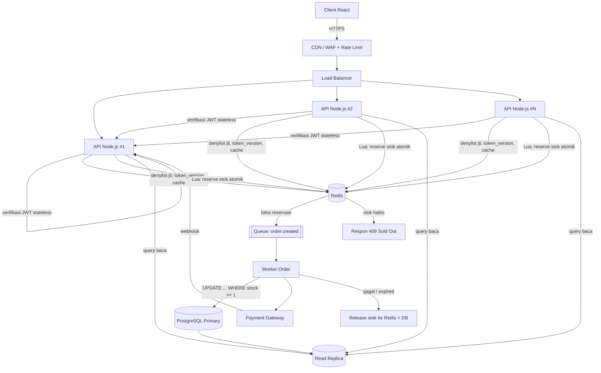

# Work Sample Test: Fullstack Development & Business Systems

**Nama Kandidat:** _[isi nama Anda]_
**Posisi:** Fullstack React Engineer
**Tanggal:** _[isi tanggal]_

## Cara Menjalankan (Soal #1)

```bash
npm install && npm start
```

Buka URL yang muncul di terminal (default `http://localhost:5173`). Fitur di halaman:

- **Pengukur render** di bagian atas: jumlah baris yang dirender per detik beserta grafik 30 detik terakhir.
- **Sebelum (naive) / Sesudah (optimized)**: ganti versi tabel dan lihat perbedaannya langsung di grafik.
- **Kolom pencarian** (memakai `useDeferredValue`) agar mengetik tetap responsif saat memfilter 5.000 item.
- **Ganti status**: ubah status satu produk. Baris yang baru berubah disorot sebentar.

Kode ada di folder `/src`.

## Daftar Isi

1. [Optimasi Performa & State Management React](#soal-1)
2. [Arsitektur Backend, JWT, & High-Concurrency](#soal-2)
3. [Integrasi API, Webhook Reliability, & Resiliency](#soal-3)
4. [TCO & Monolith vs Microservices](#soal-4)
5. [Prioritisasi Fitur, LTV/CAC, & Tech Debt](#soal-5)

---

<a id="soal-1"></a>
## Soal #1: Optimasi Performa & State Management React

### 1.1 Diagnosa: kenapa seluruh dashboard re-render?

Re-render di React terjadi ketika sebuah komponen **state-nya berubah, parent-nya re-render, atau context yang dikonsumsinya berubah**. Untuk tabel 5.000 baris, penyebab yang paling sering adalah gabungan dari hal berikut:

| # | Penyebab | Dampak |
|---|----------|--------|
| 1 | **State terpusat di parent**: `const [products, setProducts] = useState([...5000])`. Update satu item membuat array baru, sehingga parent re-render. | Semua child ikut dirender ulang karena parent-nya berubah. |
| 2 | **Child tidak di-memo**: tanpa `React.memo`, child selalu re-render kalau parent re-render, walaupun props-nya sama. | 5.000 render function dieksekusi untuk satu perubahan. |
| 3 | **Referensi props tidak stabil**: handler inline (`onClick={() => ...}`), object/array literal (`style={{...}}`) dibuat ulang di tiap render. | `React.memo` jadi tidak berguna karena shallow compare selalu gagal. |
| 4 | **Satu Context besar** berisi seluruh data. Semua consumer ikut render saat nilai context berubah. | Re-render global, sekalipun hanya satu item yang berubah. |
| 5 | **Tanpa virtualization**: 5.000 baris × beberapa elemen = puluhan ribu DOM node. | Biaya reconciliation, layout, dan paint tinggi walaupun hanya 20 baris yang terlihat. |
| 6 | **Update real-time tanpa batching**: tiap pesan WebSocket memicu `setState` sendiri. | Banyak render beruntun dalam satu detik. |

**Cara memverifikasi sebelum mengoptimasi:** gunakan React DevTools Profiler (aktifkan _"Record why each component rendered"_) dan Chrome Performance tab. Jangan menebak. Pastikan memang jumlah render yang menjadi masalah, bukan misalnya kalkulasi berat atau layout thrashing.

### 1.2 Solusi (3 lapis)

**Lapis 1: Virtualization (`react-window`).** Hanya baris yang terlihat di viewport (ditambah sedikit overscan) yang dirender. Dari 5.000 komponen menjadi sekitar 20 sampai 30 komponen. Ini perbaikan dengan dampak terbesar.

**Lapis 2: State ter-normalisasi dengan subscription per item.** Data disimpan sebagai `{ ids: [...], byId: {...} }` di store eksternal. Setiap `Row` hanya subscribe ke produknya sendiri memakai `useSyncExternalStore`. Saat produk `P-42` berubah, hanya listener milik `P-42` yang dipanggil. Parent dan baris lain tidak tahu apa-apa.

**Lapis 3: Referensi stabil dan memoization.** `React.memo(Row, areEqual)`, `itemData` dibungkus `useMemo`, handler berupa fungsi dengan referensi permanen (setara `useCallback` tanpa dependency). Update real-time dikirim sebagai **batch** supaya satu pesan yang berisi banyak perubahan hanya memicu satu putaran notifikasi.

### 1.3 Implementasi

Source lengkap ada di `/src`. Cuplikan intinya:

**`src/store.js`: store dengan subscription per item**

```js
import { useSyncExternalStore } from 'react';

let ids = [];
let byId = {};
const listeners = new Map(); // id -> Set<fn>

function subscribeToId(id, fn) {
  let set = listeners.get(id);
  if (!set) listeners.set(id, (set = new Set()));
  set.add(fn);
  return () => set.delete(fn);
}

export function applyUpdates(updates) {
  const touched = new Set();
  for (const { id, patch } of updates) {
    byId[id] = { ...byId[id], ...patch }; // referensi baru HANYA untuk item ini
    touched.add(id);
  }
  touched.forEach((id) => listeners.get(id)?.forEach((fn) => fn()));
}

export function useProduct(id) {
  return useSyncExternalStore(
    (fn) => subscribeToId(id, fn),
    () => byId[id],
  );
}
```

**`src/OptimizedTable.jsx`: virtualized list + Row yang di-memo**

```jsx
import React, { memo, useEffect, useMemo } from 'react';
import { FixedSizeList as List, areEqual } from 'react-window';
import { applyUpdates, cycleStatus, startSimulator, useProduct } from './store.js';
import { RowView, TableHead } from './RowView.jsx';

const ProductRow = memo(function ProductRow({ index, style, data }) {
  const id = data.ids[index];
  const product = useProduct(id); // hanya re-render jika produk INI berubah
  return <RowView product={product} style={style} onChange={data.onChange} />;
}, areEqual);

const itemKey = (index, data) => data.ids[index];

function OptimizedTable({ ids }) {
  // itemData stabil selama daftar id tidak berubah
  const itemData = useMemo(() => ({ ids, onChange: cycleStatus }), [ids]);

  useEffect(() => startSimulator(applyUpdates), []); // simulasi WebSocket/SSE

  return (
    <>
      <TableHead />
      <List height={480} width="100%" itemCount={ids.length} itemSize={44}
            itemData={itemData} itemKey={itemKey} overscanCount={8}>
        {ProductRow}
      </List>
    </>
  );
}

export default memo(OptimizedTable);
```

Versi lengkap di repo juga menyorot baris yang baru berubah dan menampilkan state kosong saat pencarian tidak menemukan hasil.

`NaiveTable.jsx` berisi versi "sebelum" (state array di parent, handler inline, tanpa memo, tanpa virtualization) sebagai pembanding. Pada mode naive, pengukur _baris dirender per detik_ mencapai sekitar 20.000 (4 siklus pembaruan per detik × 5.000 baris); pada mode optimized angkanya hampir selalu 0 sampai beberapa saja, karena hanya baris yang sedang terlihat dan benar-benar berubah yang dirender (ditambah baris baru saat scroll atau saat tombol Ganti status diklik).

### 1.4 Strategi state management yang tepat

Prinsip: **state diletakkan sedekat mungkin dengan pemakainya, dan komponen subscribe hanya ke potongan data yang dibutuhkan (_selector_).**

| Pendekatan | Kapan dipakai | Catatan |
|------------|---------------|---------|
| **Store eksternal + `useSyncExternalStore`** (seperti di sample ini) | Dataset besar, update sering | Kontrol penuh, tanpa dependency. |
| **Zustand** dengan selector (`useStore(s => s.byId[id])`) | Pilihan praktis di produksi | Dasarnya sama: subscription per selector. |
| **Redux Toolkit** `createEntityAdapter` + `useSelector` per id | Tim sudah memakai Redux | Normalisasi bawaan, selector harus stabil. |
| **TanStack Query** | Data berasal dari server | Atur `select` dan `structuralSharing`. Cocok untuk server state, bukan untuk update realtime per item. |
| **React Context** untuk seluruh data | **Dihindari** untuk kasus ini | Semua consumer re-render saat value berubah. |

Praktik pendukung lainnya:

- **Normalisasi data** (`byId` + `ids`) supaya update O(1) dan referensi item lain tidak berubah (_structural sharing_).
- **Batching update real-time** (gabungkan pesan WebSocket per ~100 sampai 250 ms atau per `requestAnimationFrame`).
- **`useDeferredValue` / `startTransition`** untuk filter dan sort agar input tetap responsif.
- **Server-side pagination, filter, dan sort** kalau data terus bertambah. Virtualization menyelesaikan masalah render, tetapi bukan masalah ukuran payload.
- **Jangan memo-kan semuanya.** Memoization punya biaya (perbandingan props, memori). Terapkan di titik yang terbukti mahal berdasarkan profiling.

---

<a id="soal-2"></a>
## Soal #2: Arsitektur Backend, Autentikasi JWT, & High-Concurrency Scaling

### 2.1 Pilihan tech stack dan alasannya

**Pilihan: Node.js (TypeScript) + Fastify, PostgreSQL, Redis, dan message queue (BullMQ di atas Redis, atau RabbitMQ/SQS).**

| Komponen | Alasan |
|----------|--------|
| **Node.js + TypeScript** | Beban Flash Sale didominasi I/O (DB, Redis, network). Event loop non-blocking cocok untuk itu. Satu bahasa dengan frontend React, sehingga tipe, validasi (Zod), dan kontrak API bisa dibagi. Tim kecil lebih cepat. Fastify memberi throughput lebih tinggi dari Express. |
| **PostgreSQL** | Transaksi ACID, row-level locking, dan constraint (`CHECK (stock >= 0)`) membuat integritas stok bisa dijamin di level database. |
| **Redis** | Counter stok atomik (Lua), denylist token, rate limit, cache, dan backend queue. |
| **Queue** | Memisahkan _hot path_ (reservasi stok) dari pekerjaan berat (email, invoice, sinkronisasi) dan meratakan lonjakan trafik. |
| **Stateless app server di belakang load balancer** | Scale horizontal dengan menambah instance. Autoscaling berdasar CPU atau request rate. |

Catatan jujur: untuk beban CPU-bound yang berat (mis. kalkulasi harga kompleks, image processing), bagian itu sebaiknya dipisah ke worker terpisah, atau ditulis dengan Go. Untuk fase ini, Node.js sudah memadai dan biaya pengembangan paling rendah.

### 2.2 Token Revocation pada JWT tanpa merusak sifat stateless

JWT murni stateless memang tidak bisa dicabut sebelum `exp`. Kuncinya adalah **tidak mengandalkan satu mekanisme**, tetapi menggabungkan beberapa dengan biaya state minimal:

1. **Access token berumur pendek (5 sampai 15 menit).** Ini mengecilkan _blast radius_. Verifikasi tetap 100% stateless (cek signature dan `exp`), jadi tidak ada lookup per request.
2. **Refresh token opaque, berumur panjang, disimpan di server (DB/Redis), dan di-_rotate_ setiap dipakai.** Dikirim lewat cookie `HttpOnly; Secure; SameSite`. Logout = hapus refresh token tersebut. Jika refresh token lama dipakai lagi (_reuse detection_), seluruh token family dicabut karena indikasi pencurian.
3. **Denylist `jti` di Redis dengan TTL = sisa umur token.** Saat logout atau akun diretas, `jti` access token dimasukkan ke Redis (`SET revoked:{jti} 1 EX <sisa_detik>`). Datanya otomatis hilang sendiri sehingga ukurannya kecil dan terbatas.
4. **`token_version` per user untuk "logout dari semua perangkat".** Klaim `tv` ada di JWT. Mengganti password atau force-logout cukup menaikkan `tv` user (di-cache di Redis). Token dengan `tv` lama ditolak.
5. **Pemeriksaan hanya untuk jalur sensitif.** Endpoint biasa (baca katalog) cukup validasi stateless. Endpoint sensitif (checkout, ubah password, ubah email) tambahan memeriksa denylist dan `tv` di Redis (lookup O(1), sekitar sub-milidetik).

Trade-off: sistem menjadi _hybrid_, bukan stateless 100%. Namun state yang disimpan kecil, ber-TTL, dan hanya dibaca di tempat yang memang perlu. Inilah kompromi standar di industri.

```ts
// Middleware verifikasi (ringkas)
async function authenticate(req, reply) {
  const token = extractBearer(req);
  const payload = jwt.verify(token, PUBLIC_KEY, { algorithms: ['RS256'] }); // stateless

  if (req.routeOptions.config.sensitive) {
    const [revoked, tv] = await redis.mget(`revoked:${payload.jti}`, `user:${payload.sub}:tv`);
    if (revoked || Number(tv ?? 0) !== payload.tv) throw new UnauthorizedError();
  }
  req.user = payload;
}
```

Tips keamanan lain: gunakan `RS256`/`EdDSA` (kunci publik bisa dibagikan ke service lain), whitelist algoritma, rotasi kunci dengan `kid`, dan jangan menyimpan data sensitif di payload.

### 2.3 Race Condition: 100 user membeli 1 sisa barang

**Masalah klasik _check-then-act_:**

```text
User A: SELECT stock -> 1   |  User B: SELECT stock -> 1
User A: UPDATE stock = 0    |  User B: UPDATE stock = 0   -> terjual 2x (oversell)
```

**Solusi utama (SQL): pengecekan dan pengurangan dalam satu statement atomik.**

```sql
UPDATE products
SET    stock = stock - 1
WHERE  id = $1 AND stock >= 1;   -- cek + kurangi dalam 1 operasi atomik
-- rows affected = 1 -> berhasil, 0 -> stok habis
```

PostgreSQL mengunci baris saat `UPDATE`, sehingga 100 request yang bersamaan akan diserialisasi. Tepat satu yang mendapat `rows affected = 1`. Tambahkan `CHECK (stock >= 0)` sebagai _safety net_ terakhir.

**Alternatif dan kapan dipakai:**

| Strategi | Cara kerja | Kelebihan | Kekurangan |
|----------|-----------|-----------|------------|
| **Atomic conditional UPDATE** (rekomendasi) | Lihat di atas | Sederhana, benar, tanpa lock eksplisit | Baris panas menjadi titik antrean |
| **Pessimistic lock** `SELECT ... FOR UPDATE` dalam transaksi | Kunci baris, baca, lalu tulis | Cocok jika logika di antaranya kompleks | Lock lebih lama, risiko deadlock jika urutan lock tidak konsisten |
| **Optimistic locking** (kolom `version`) | `UPDATE ... WHERE id=$1 AND version=$2` | Tanpa lock lama | Banyak retry saat kontensi tinggi, buruk untuk Flash Sale |
| **Redis atomic pre-reservation (Lua)** | `DECR` stok di Redis, hanya yang berhasil lanjut ke DB | Menyerap lonjakan, DB terlindungi | Perlu rekonsiliasi Redis dan DB |
| **Queue serial per SKU** | Request masuk antrean, worker memproses berurutan | Tidak ada kontensi sama sekali | Latensi lebih tinggi, kompleksitas bertambah |

**NoSQL (contoh MongoDB):** operasi atomik per dokumen.

```js
const res = await db.collection('products').findOneAndUpdate(
  { _id: sku, stock: { $gte: 1 } },   // filter menjadi guard
  { $inc: { stock: -1 } },
  { returnDocument: 'after' },
);
if (!res) throw new SoldOutError();
```

DynamoDB memakai pola yang sama lewat `ConditionExpression: "stock >= :one"`.

**Rancangan untuk Flash Sale (beban ribuan RPS):** satu baris stok yang sangat panas akan menjadi bottleneck di DB. Maka:

1. **Redis Lua script** melakukan reservasi stok secara atomik. Hanya N request pertama yang lolos, sisanya langsung ditolak dengan "stok habis" tanpa menyentuh DB.
2. Pemesanan yang lolos dibuat berstatus `PENDING` dengan **TTL pembayaran** (mis. 10 menit) dan masuk queue.
3. Worker menulis ke Postgres dengan **conditional UPDATE** sebagai sumber kebenaran akhir.
4. Jika pembayaran gagal atau kedaluwarsa, stok **dikembalikan** (Redis dan DB).
5. Tambahkan **idempotency key** pada endpoint checkout supaya klik ganda atau retry tidak membuat order ganda.

```lua
-- reserve.lua (atomik di Redis)
local stock = tonumber(redis.call('GET', KEYS[1]) or '0')
if stock >= tonumber(ARGV[1]) then
  redis.call('DECRBY', KEYS[1], ARGV[1])
  return 1
end
return 0
```

### 2.4 Diagram alur arsitektur (Mermaid)



---

<a id="soal-3"></a>
## Soal #3: Integrasi API, Webhook Reliability, & Resiliency

### 3.1 Idempotency pada endpoint webhook

**Prinsip:** Payment gateway menjamin pengiriman _at-least-once_, artinya event yang sama **bisa datang berkali-kali dan tidak berurutan**. Handler kita harus menghasilkan efek yang sama, berapa kali pun event diterima.

Langkah di handler:

1. **Verifikasi signature** (HMAC) dan timestamp terhadap raw body untuk mencegah spoofing dan replay.
2. **Catat `event_id` dengan unique constraint**. Duplikat langsung terdeteksi oleh database, bukan oleh `if` di aplikasi (yang rentan race).
3. **Respon 2xx secepat mungkin**, lalu proses di background lewat queue. Dengan begitu gateway tidak timeout lalu retry tanpa perlu.
4. **State machine pembayaran yang monoton**. Status hanya boleh maju (`PENDING → PAID`, tidak boleh `PAID → PENDING`). Event yang datang terlambat atau out-of-order tidak akan merusak data.
5. **Transaksi tunggal**: insert event, update order, dan insert ke outbox (untuk notifikasi) dalam satu transaksi database.

```sql
CREATE TABLE webhook_events (
  event_id    TEXT PRIMARY KEY,           -- ID unik dari gateway
  provider    TEXT NOT NULL,
  payload     JSONB NOT NULL,
  status      TEXT NOT NULL DEFAULT 'RECEIVED', -- RECEIVED | PROCESSED | FAILED
  received_at TIMESTAMPTZ NOT NULL DEFAULT now()
);

CREATE TABLE payments (
  id         UUID PRIMARY KEY,
  order_id   UUID NOT NULL,
  status     TEXT NOT NULL,               -- PENDING | PAID | FAILED | EXPIRED | REFUNDED
  updated_at TIMESTAMPTZ NOT NULL DEFAULT now()
);
```

```ts
app.post('/webhooks/payment', { config: { rawBody: true } }, async (req, reply) => {
  if (!verifySignature(req.rawBody, req.headers['x-signature'])) return reply.code(401).send();

  const evt = req.body;
  // INSERT ... ON CONFLICT DO NOTHING -> rowCount 0 berarti duplikat
  const { rowCount } = await db.query(
    `INSERT INTO webhook_events (event_id, provider, payload)
     VALUES ($1, 'gateway-x', $2) ON CONFLICT (event_id) DO NOTHING`,
    [evt.id, evt],
  );
  if (rowCount === 0) return reply.code(200).send({ status: 'duplicate_ignored' });

  await queue.add('process-payment-event', { eventId: evt.id }); // proses async
  return reply.code(200).send({ status: 'accepted' });
});

// Worker: transisi status hanya boleh maju (dijaga di SQL)
await db.query(
  `UPDATE payments SET status = 'PAID', updated_at = now()
   WHERE order_id = $1 AND status = 'PENDING'`,   -- PAID/FAILED tidak ditimpa lagi
  [orderId],
);
```

Untuk request yang kita **kirim** ke gateway (membuat charge), gunakan juga **Idempotency-Key** (mis. `order_id`) agar retry karena timeout tidak membuat tagihan ganda.

### 3.2 Strategi fallback dan retry untuk pembayaran yang menggantung

Webhook adalah _hint_, bukan satu-satunya sumber kebenaran. Gunakan beberapa lapis pengaman:

| Lapis | Mekanisme | Detail |
|-------|-----------|--------|
| 1 | **Retry dari gateway** | Sebagian besar gateway melakukan retry dengan backoff selama beberapa jam sampai hari bila kita membalas non-2xx. |
| 2 | **Retry internal di worker** | Retry dengan **exponential backoff + jitter** (mis. 5s, 30s, 2m, 10m, 1j). Hanya untuk error sementara (5xx, timeout). Error permanen (validasi) tidak di-retry. |
| 3 | **Dead Letter Queue (DLQ)** | Setelah N kali gagal, pesan dipindah ke DLQ. Ada alert dan dashboard, serta tombol _replay_ manual setelah bug diperbaiki. Tidak ada event yang hilang diam-diam. |
| 4 | **Reconciliation job (cron)** | Tiap 1 sampai 5 menit: cari pembayaran `PENDING` yang lebih tua dari X menit, lalu **tanya langsung ke API gateway** (`GET /payments/{id}`) dan sinkronkan status. Ini jaring pengaman utama bila webhook benar-benar hilang. |
| 5 | **Rekonsiliasi harian** | Cocokkan laporan settlement gateway dengan data sendiri untuk menangkap selisih. |
| 6 | **Expiry** | Pembayaran yang melewati batas waktu otomatis ditandai `EXPIRED`, lalu stok dikembalikan. |

Fallback ini harus memakai **jalur kode yang sama** dengan handler webhook (satu fungsi `applyPaymentStatus()` yang idempotent), supaya tidak ada dua logika yang bisa berbeda.

**Observability:** metrik `pending_payment_age_p95`, jumlah DLQ, dan rasio webhook gagal, dengan alert bila melewati ambang.

### 3.3 Komunikasi status ke user (Frontend React)

| Opsi | Kelebihan | Kekurangan | Cocok untuk |
|------|-----------|------------|-------------|
| **Polling** | Paling sederhana, melewati proxy/firewall dengan mudah | Boros request jika interval pendek, ada delay | Fallback |
| **Server-Sent Events (SSE)** | Satu arah server ke client, ringan, auto-reconnect bawaan, berjalan di HTTP biasa | Satu arah saja | **Pilihan utama** untuk status pembayaran |
| **WebSocket** | Dua arah, latensi paling rendah | Perlu infrastruktur sticky/pub-sub, lebih kompleks | Chat, kolaborasi realtime |

**Rekomendasi: SSE dengan fallback ke polling adaptif.** Status pembayaran bersifat satu arah (server mengabari client), jadi WebSocket berlebihan. Di backend, worker yang memproses webhook mem-publish event ke Redis Pub/Sub, lalu instance API yang memegang koneksi SSE meneruskannya ke browser.

```tsx
function usePaymentStatus(orderId: string) {
  const [status, setStatus] = useState<'PENDING' | 'PAID' | 'FAILED' | 'EXPIRED'>('PENDING');

  useEffect(() => {
    if (status !== 'PENDING') return;           // berhenti saat status final
    let cancelled = false;
    let timer: ReturnType<typeof setTimeout>;
    let delay = 2000;

    const startPolling = () => {                // fallback: polling dengan backoff
      const tick = async () => {
        const res = await fetch(`/api/orders/${orderId}/payment`);
        const data = await res.json();
        if (cancelled) return;
        setStatus(data.status);
        if (data.status === 'PENDING') {
          delay = Math.min(delay * 1.5, 15000);  // 2s -> 3s -> ... maks 15s
          timer = setTimeout(tick, delay);
        }
      };
      tick();
    };

    const es = new EventSource(`/api/orders/${orderId}/payment/stream`);
    es.onmessage = (e) => setStatus(JSON.parse(e.data).status);
    es.onerror = () => { es.close(); startPolling(); };

    return () => { cancelled = true; es.close(); clearTimeout(timer); };
  }, [orderId, status]);

  return status;
}
```

Praktik UX yang menyertainya:

- Tampilkan state jelas ("Menunggu pembayaran…"), jangan biarkan spinner tanpa batas. Beri **timeout UI** dan pesan _"Pembayaran sedang diverifikasi, kami akan kabari lewat email/notifikasi"_.
- **Optimistic UI hanya untuk tampilan sementara.** Status final selalu dari server.
- Hentikan polling saat tab tidak aktif (`document.visibilityState`) dan saat status sudah final.
- Sertakan juga notifikasi email atau push sebagai jalur cadangan bila user menutup halaman.

---

<a id="soal-4"></a>
## Soal #4: Evaluasi TCO & Trade-off Monolith vs Microservices

> Angka di bawah adalah **estimasi kasar** untuk ilustrasi (tarif cloud berbeda per region dan berubah dari waktu ke waktu). Yang penting adalah **orde besarnya dan struktur biayanya**, bukan angka presisi.

### 4.1 Analisis TCO

**Kondisi saat ini (monolith):** ≈ **$150/bulan** (≈ $1.800/tahun) untuk server, DB, dan backup.

**Skenario migrasi ke Cloud-Native Microservices (estimasi bulanan):**

| Komponen | Estimasi/bulan | Catatan |
|----------|---------------:|---------|
| Kubernetes (EKS/GKE) control plane + node minimum untuk HA | $200 – $600 | Control plane EKS saja sekitar $73. Perlu ≥ 3 node agar HA. |
| Managed DB (multi-AZ), kemungkinan beberapa DB per service | $200 – $800 | Prinsip _database per service_ melipatgandakan biaya. |
| Load balancer, NAT gateway, data transfer antar-AZ | $100 – $400 | Sering luput dihitung, dan NAT gateway terkenal "mengejutkan". |
| Observability (logging, metrics, tracing terpusat) | $100 – $500 | Volume log dan trace melonjak pada arsitektur terdistribusi. |
| Message broker, service mesh, API gateway, secrets, registry | $100 – $400 | |
| Environment staging/dev tambahan | $200 – $600 | |
| **Total infrastruktur** | **≈ $900 – $3.300** | **6× sampai 20× dari $150** |

**Biaya terbesar bukan infrastruktur, melainkan orang:**

- Kebutuhan **0,5 sampai 1 FTE DevOps/Platform engineer** (di banyak pasar ≈ $2.000 sampai $8.000+/bulan, tergantung lokasi).
- Pengembang melambat: waktu belajar Kubernetes dan tooling, menjaga kontrak antar-service, debugging terdistribusi.
- Beban on-call dan operasional meningkat.

**Kesimpulan:** untuk startup skala awal-menengah, **migrasi langsung ke microservices tidak menguntungkan secara bisnis**. Biaya total naik sekitar satu orde besarnya, sementara nilai bisnisnya (skala ekstrem, otonomi puluhan tim) belum dibutuhkan. Waktu 3 sampai 6 bulan yang dihabiskan untuk migrasi adalah **opportunity cost**: fitur yang tidak dikirim dan pendapatan yang tidak tumbuh.

Microservices menjawab masalah **organisasi dan skala** (banyak tim yang harus deploy independen, beban yang sangat berbeda antar-modul). Jika tim masih 5 sampai 15 engineer dan beban masih muat dalam beberapa server, masalah itu belum ada.

### 4.2 Hidden costs microservices

**Infrastruktur**

- Biaya jaringan (NAT, cross-AZ, load balancer per service) dan _idle capacity_ karena tiap service perlu resource minimum.
- Duplikasi stack: DB, cache, dan pipeline CI/CD per service.
- Tooling observability, service mesh, dan secrets management yang harus dibayar dan dirawat.

**Operasional dan engineering**

- **Kompleksitas distributed system:** latensi jaringan, partial failure, retry, timeout, circuit breaker, dan _cascading failure_ harus ditangani eksplisit.
- **Konsistensi data:** tidak ada transaksi ACID lintas service. Dibutuhkan Saga, outbox, dan _eventual consistency_ (dan itu sulit diuji).
- **Versioning kontrak API** antar-service dan koordinasi rilis.
- **Debugging dan testing:** perlu distributed tracing, test kontrak, dan environment integrasi yang mahal.
- **Overhead cognitive dan onboarding:** engineer baru butuh waktu lebih lama untuk paham sistem.
- **Keamanan:** permukaan serangan meluas (mTLS, authN/authZ antar-service, patching banyak image).
- **Risiko "distributed monolith":** service yang terlalu terikat satu sama lain sehingga mendapat semua kerugian microservices tanpa manfaatnya.

### 4.3 Rekomendasi: Modular Monolith + ekstraksi selektif

```text
Fase 0 (minggu 1-2)  : Ukur dulu. Profiling, load test, cari bottleneck sebenarnya.
Fase 1 (bulan 1-2)   : Modular monolith. Pisahkan domain (catalog, order, payment, user)
                       ke modul dengan batas jelas dan API internal. Tidak boleh akses
                       tabel modul lain langsung.
Fase 2 (bulan 2-3)   : Scale vertikal + horizontal sederhana. 2+ instance app di belakang
                       load balancer, managed Postgres (+ read replica), Redis, CDN,
                       background worker + queue untuk pekerjaan berat.
Fase 3 (hanya jika terbukti perlu): Ekstrak 1 modul yang benar-benar butuh scaling atau
                       deploy mandiri (mis. payment-webhook worker atau search), dengan
                       pola Strangler Fig.
```

Estimasi biaya arsitektur kompromi: **≈ $300 sampai $700/bulan** (2 app instance, managed Postgres + replica, Redis, CDN, monitoring SaaS ringan), dengan **tanpa tambahan headcount DevOps**. Itu pertambahan yang proporsional dengan pertumbuhan trafik.

**Pemicu untuk mulai mengekstrak service** (_bukan_ berdasarkan selera):

- Tim > ~20 engineer dan sering saling menghambat saat deploy.
- Satu modul punya profil beban yang sangat berbeda (mis. CPU-heavy) sehingga mendorong biaya scale seluruh aplikasi.
- Kebutuhan isolasi kegagalan atau kepatuhan (mis. modul pembayaran).
- Sudah ada kapabilitas platform: CI/CD matang, observability, dan tim yang paham operasi.

Prinsip penutup: _"Jangan bayar kompleksitas di muka untuk skala yang belum dimiliki."_ Modular monolith menjaga opsi untuk memecah di kemudian hari, tanpa membayar biayanya hari ini.

---

<a id="soal-5"></a>
## Soal #5: Prioritisasi Fitur, Metrik Software (LTV/CAC), & Handling Tech Debt

### 5.1 Mengkomunikasikan Technical Debt ke PM dan stakeholder non-teknis

**Prinsip:** terjemahkan dari bahasa teknis ke **bahasa risiko, uang, dan waktu**. Stakeholder tidak peduli "coupling tinggi" atau "tidak ada test", tetapi mereka peduli target revenue, reputasi, dan jadwal.

**Pendekatan komunikasi:**

1. **Pakai analogi finansial.** Tech debt itu seperti **utang berbunga**. Setiap sprint kita membayar "bunga" berupa fitur yang makin lambat dibuat, bug yang makin sering, dan insiden yang makin berisiko. Tidak dibayar → bunganya membesar.
2. **Kuantifikasi, jangan hanya mengeluh.**
   - _Risiko:_ "Ada ~X% kemungkinan downtime di campaign berikutnya. Dengan revenue $Y/jam, perkiraan kerugiannya $Z."
   - _Kecepatan:_ "Fitur serupa dulu butuh 3 hari, sekarang 8 hari karena modul checkout rapuh."
   - _Kualitas:_ jumlah bug produksi, MTTR, _change failure rate_, dan waktu build/deploy.
3. **Tawarkan opsi dan trade-off, bukan ultimatum.** Contoh: Opsi A (semua 3 fitur, risiko tinggi), Opsi B (2 fitur + perbaikan area kritis), Opsi C (1 fitur + stabilisasi besar). Biarkan PM memilih dengan informasi lengkap.
4. **Hubungkan dengan tujuan PM.** Target mereka adalah CAC. Server down saat kampanye berarti **uang iklan terbuang** (trafik berbayar masuk ke halaman error), sehingga CAC efektif **naik**.
5. **Tunjukkan bukti**: grafik error rate, riwayat insiden, dan demo singkat area yang rapuh.

**Contoh kalimat:**

> "Kampanye minggu depan akan mendorong trafik sekitar 3× normal. Modul checkout kami saat ini gagal di ~2× beban normal (hasil load test). Jika down 2 jam, kita kehilangan sekitar $X penjualan dan membuang sekitar $Y biaya iklan. Perbaikannya butuh 4 hari. Saya usulkan kita kirim 2 dari 3 fitur dan pakai 4 hari itu untuk mengamankan checkout."

### 5.2 Hubungan kualitas sistem dengan Churn dan LTV

**Rumus dasar (sederhana):**

```text
Churn Rate   = pelanggan hilang dalam periode / pelanggan di awal periode
Umur rata-rata pelanggan ≈ 1 / Churn Rate (bulanan)
LTV          = ARPU × Gross Margin × (1 / Churn Rate)
CAC Payback  = CAC / (ARPU × Gross Margin)   -> dalam bulan
Rasio sehat  : LTV / CAC ≥ 3   dan   payback < 12 bulan
```

**Rantai sebab-akibat:**

```text
Tech debt ↑ → bug, lag, downtime ↑ → pengalaman buruk, checkout gagal
            → Churn ↑ & konversi ↓ → umur pelanggan ↓ → LTV ↓
            → LTV/CAC ↓  (dan CAC efektif ↑ karena konversi turun)
```

**Contoh numerik (ilustrasi):**

| | Sistem stabil | Sistem rapuh |
|---|---:|---:|
| ARPU/bulan | $20 | $20 |
| Gross margin | 70% | 70% |
| Churn bulanan | 3% | 5% |
| Umur pelanggan | ≈ 33 bulan | ≈ 20 bulan |
| **LTV** | **≈ $467** | **≈ $280** |
| CAC | $100 | $100 |
| **LTV/CAC** | **4,7** | **2,8 (di bawah ambang 3)** |

Dua poin persentase churn saja sudah menurunkan LTV sekitar 40% dan membuat unit economics melewati batas sehat. Jadi **reliabilitas adalah fitur bisnis**, bukan sekadar urusan engineering. Dampak lainnya: kehilangan penjualan langsung saat down, biaya support naik, rating dan reputasi turun, serta kepercayaan pada kampanye pemasaran berikutnya menurun.

**Metrik jembatan** (bahasa bersama engineering dan bisnis): SLO/uptime, error rate checkout, p95 latency halaman kunci, DORA metrics (deployment frequency, lead time, change failure rate, MTTR), dan **konversi checkout**.

### 5.3 Framework prioritisasi dan pembagian kapasitas sprint

**Langkah konkret:**

**Langkah 1: Klasifikasikan semua pekerjaan** ke dalam tiga kategori:

- **Critical risk** (bisa menyebabkan outage atau kehilangan data): wajib dikerjakan, tidak bisa ditawar.
- **Fitur bisnis** (mengejar CAC, konversi, retensi).
- **Debt ber-bunga tinggi** (memperlambat banyak pekerjaan lain), dan **debt ber-bunga rendah** (jelek tapi stabil, boleh ditunda).

**Langkah 2: Skoring dengan kerangka yang sama.** Gunakan **RICE** untuk fitur, dan perlakukan debt dengan skala yang sebanding:

```text
Skor = (Reach × Impact × Confidence) / Effort
Untuk debt:  Impact = (kerugian yang dicegah + waktu engineering yang dihemat)
             Reach  = jumlah user/tim yang terdampak
Tambahkan "risk multiplier" (×2 sampai ×3) untuk item dengan risiko outage terbukti.
```

Alternatif: **WSJF** (Cost of Delay ÷ Duration), karena Cost of Delay sudah mencakup nilai bisnis, urgensi waktu, dan pengurangan risiko.

**Langkah 3: Tetapkan alokasi kapasitas sebagai kebijakan tim.** Titik awal yang masuk akal:

| Kondisi | Fitur | Tech debt / reliability | Buffer (bug, insiden) |
|---------|------:|------------------------:|----------------------:|
| Normal | 60–70% | 20–25% | 10–15% |
| **Risiko tinggi (kasus ini)** | **40–50%** | **40–50%** | **10%** |
| Setelah risiko turun | kembali ke 60–70% | 20–25% | 10–15% |

Dalam skenario ini, risiko server down itu nyata, jadi sprint ini memakai baris "risiko tinggi" yang bersifat **sementara dan berbatas waktu**, bukan permanen.

**Langkah 4: Kerjakan sprint ini dengan urutan berikut:**

1. **Stabilisasi minimum dulu** (_guardrails_, bukan refactor besar): monitoring dan alert, load test kecil, rate limit, perbaikan N+1/index yang jelas, timeout/circuit breaker, backup dan rollback plan.
2. **Fitur dikirim dalam versi paling kecil** (MVP slice) di balik **feature flag** supaya bisa dimatikan cepat bila bermasalah, dan dirilis bertahap (canary).
3. **Negosiasi scope, bukan kualitas:** 3 fitur → 1 atau 2 fitur prioritas tertinggi untuk CAC (pilih berdasarkan RICE), sisanya masuk sprint berikutnya.
4. **Debt dibayar sambil jalan:** aturan _Boy Scout_ (merapikan area yang sedang disentuh fitur) dan "pagar" kualitas di CI (lint, test pada modul kritis).

**Langkah 5: Jaga disiplin jangka panjang.**

- Simpan **tech debt register** yang terlihat oleh PM (item, dampak, estimasi, skor).
- Tetapkan **error budget**: jika SLO terlewati, kapasitas otomatis bergeser ke reliability. Aturannya disepakati di awal sehingga tidak menjadi perdebatan tiap sprint.
- **Review tiap kuartal:** apakah debt turun, apakah insiden berkurang, dan apakah kecepatan membaik. Hasilnya dilaporkan dalam bahasa bisnis.

**Contoh pembagian sprint (kapasitas 40 poin):**

| Item | Poin | Alasan |
|------|-----:|--------|
| Fitur #1 (prioritas RICE tertinggi, MVP slice + flag) | 12 | Langsung mendukung target CAC |
| Fitur #2 (MVP slice + flag) | 8 | Berdampak, scope dipangkas |
| Guardrail stabilitas (monitoring, rate limit, fix bottleneck checkout) | 14 | Menutup risiko downtime yang terbukti |
| Buffer bug/insiden | 4 | Realistis |
| Spike/riset refactor sprint berikutnya | 2 | Mulai mengurangi ketidakpastian |
| Fitur #3 | 0 | Dijadwalkan sprint berikutnya, dikomunikasikan sejak awal |

---

## Struktur Repository

```text
.
├── README.md              # seluruh jawaban (dokumen ini)
├── package.json
├── vite.config.js
├── index.html
└── src/
    ├── main.jsx
    ├── App.jsx              # toggle versi, pencarian (useDeferredValue)
    ├── RenderMeter.jsx      # pengukur render per detik + grafik riwayat
    ├── NaiveTable.jsx       # versi "sebelum" (anti-pattern)
    ├── OptimizedTable.jsx   # versi "sesudah" (react-window + memo + store per-item)
    ├── RowView.jsx          # tampilan baris & header (dipakai kedua versi)
    ├── store.js             # store ter-normalisasi, subscription per item
    └── styles.css
```
